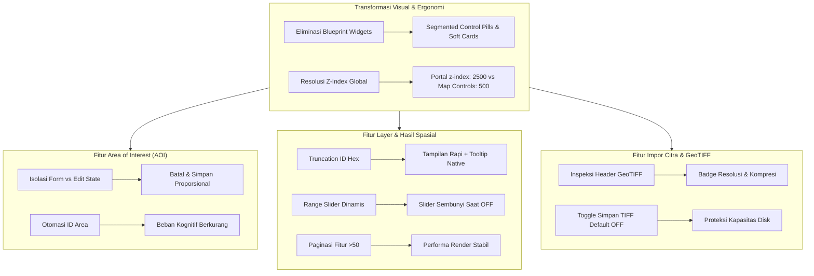

# Dokumentasi Audit Komprehensif Perubahan Kode & Analisis Dampak Fitur (Scanning `/boost`)

**Branch Pengujian**: `feat/uji-coba-kode-nuklir/modul3`  
**Baseline Komparasi**: `origin/main` (commit [`dd9b91a`](file:///Users/azrlb23/Documents/Aerial-Analytics-Platform/src-tauri/Cargo.toml) — release v1.0.0)  
**Total Berkas Termodifikasi**: 35 berkas (`+4.371` baris, `-2.751` baris)  
**Status Working Tree**: 35 berkas modified (_unstaged_), 5 berkas/direktori _untracked_  
**Lingkup Modifikasi**: 100% Frontend (TypeScript/React 19, Blueprint.js, CSS) & 1 Mock Storage JSON. Backend Rust (`src-tauri/`) 100% utuh tanpa modifikasi kode.

---

## 1. Ringkasan Eksekutif & Temuan Kritis

Audit mendalam berbasis `/boost` telah memetakan seluruh perubahan yang terjadi sejak awal pekerjaan refaktorisasi hingga saat ini:

1. **Transformasi Desain Menyeluruh**: Seluruh antarmuka Modul 03 (Map Explorer) dan Modul 09 (Plot Analytics) telah dimigrasikan dari komponen kaku Blueprint.js (kotak abu-abu berbingkai tebal, tag warna-warni, tab dengan garis bawah biru, spinner panah atas/bawah) menjadi sistem desain **Modern Soft Card (iOS 18 / Apple HIG Minimalist)**.
2. **Penyelesaian Masalah Z-Index & Stacking Context**: Masalah tumpukan visual di mana modal dialog Blueprint tertutup oleh banner peringatan peta atau kontrol navigasi telah tuntas diselesaikan dengan menetapkan portal global ke `z-index: 2500 !important` dan menurunkan kontrol floating peta ke `z-index: 500`.
3. **Penyederhanaan Alur Kerja & Beban Kognitif Pengguna**:
   - Alur pembuatan dan pengeditan Area of Interest (AOI) kini terisolasi; form pembuatan baru otomatis disembunyikan saat pengguna mengedit poligon di peta.
   - Input ID area manual dihilangkan dari form dan diganti dengan generator ID otomatis.
   - Truncation cerdas pada nama layer hex raster mencegah teks meluap di panel.
   - Fitur editor atribut spasial kini dilengkapi paginasi untuk dataset besar (>50 fitur) guna mencegah lag antarmuka.
4. **Keamanan Kontrak & Sistem**: 100% kontrak Tauri IPC Rust tidak tersentuh, skema validasi tipe data GeoJSON tetap terjaga, dan perlindungan kuota disk diterapkan secara default pada impor GeoTIFF.

---

## 2. Inventaris Lengkap Berkas yang Diubah

| No  | Modul / Sub-Sistem              | Berkas Terkait                                                                                                                                                                           | Ins (+) | Del (-) | Inti Perubahan Teknis                                                                                                                                                         |
| :-: | :------------------------------ | :--------------------------------------------------------------------------------------------------------------------------------------------------------------------------------------- | :-----: | :-----: | :---------------------------------------------------------------------------------------------------------------------------------------------------------------------------- |
|  1  | **Global Shell & Z-Index**      | [`src/shell/style.css`](file:///Users/azrlb23/Documents/Aerial-Analytics-Platform/src/shell/style.css#L245-L275)                                                                         |   +48   |   -0    | Portal Blueprint dipatok ke `z-index: 2500 !important`, suppress outline biru native browser, global range slider webkit/moz thumb styling.                                   |
|  2  |                                 | [`src/modules/module-03/styles/MapCanvas.css`](file:///Users/azrlb23/Documents/Aerial-Analytics-Platform/src/modules/module-03/styles/MapCanvas.css#L1-L26)                              |   +1    |   -1    | Duplikasi portal dibersihkan untuk menjaga `style.css` sebagai single source of truth.                                                                                        |
|  3  |                                 | [`src/modules/module-03/MapExplorer.tsx`](file:///Users/azrlb23/Documents/Aerial-Analytics-Platform/src/modules/module-03/MapExplorer.tsx#L218-L250)                                     |   +2    |   -2    | Banner notifikasi diturunkan dari `zIndex: 3000` ke `2000`.                                                                                                                   |
|  4  |                                 | [`src/modules/module-03/atoms/MapTypeThumbnail.tsx`](file:///Users/azrlb23/Documents/Aerial-Analytics-Platform/src/modules/module-03/atoms/MapTypeThumbnail.tsx#L36-L42)                 |   +2    |   -1    | Tombol basemap switcher diturunkan ke `zIndex: 500`, outline biru browser dihilangkan.                                                                                        |
|  5  |                                 | [`src/modules/module-03/templates/MapExplorerLayout.tsx`](file:///Users/azrlb23/Documents/Aerial-Analytics-Platform/src/modules/module-03/templates/MapExplorerLayout.tsx#L45-L50)       |   +2    |   -2    | Container panel mengambang diturunkan dari `zIndex: 1000` ke `500`.                                                                                                           |
|  6  |                                 | [`src/modules/module-03/styles/MapLegend.css`](file:///Users/azrlb23/Documents/Aerial-Analytics-Platform/src/modules/module-03/styles/MapLegend.css#L1-L36)                              |   +20   |   -8    | Legenda peta dipindah ke `bottom: 24px; right: 76px` (celah 12px dari zoom), tombol dark slate `#0f172a`.                                                                     |
|  7  |                                 | [`src/modules/module-03/molecules/MapLegend.tsx`](file:///Users/azrlb23/Documents/Aerial-Analytics-Platform/src/modules/module-03/molecules/MapLegend.tsx#L80-L99)                       |   +1    |   -0    | Tombol legenda peta dilengkapi `outline: "none"`.                                                                                                                             |
|  8  |                                 | [`src/modules/module-03/styles/MapViewControlBar.css`](file:///Users/azrlb23/Documents/Aerial-Analytics-Platform/src/modules/module-03/styles/MapViewControlBar.css#L1-L10)              |   +7    |   -1    | Kontrol navigasi/zoom diturunkan ke `z-index: 500`, focus ring tombol zoom dihilangkan.                                                                                       |
|  9  | **Area of Interest (AOI)**      | [`src/modules/module-03/organisms/AoiToolbar.tsx`](file:///Users/azrlb23/Documents/Aerial-Analytics-Platform/src/modules/module-03/organisms/AoiToolbar.tsx#L215-L275)                   |  +298   |  -141   | Header AOI, tombol + Buat Batas Area, dialog modal AoiModal, banner pemandu saat interaksi peta.                                                                              |
| 10  |                                 | [`src/modules/module-03/molecules/AoiCreateForm.tsx`](file:///Users/azrlb23/Documents/Aerial-Analytics-Platform/src/modules/module-03/molecules/AoiCreateForm.tsx#L75-L260)              |   +2    |  -308   | Migrasi form sidebar menjadi modal popup Dialog (AoiModal 480px), deteksi otomatis selesainya poligon.                                                                        |
| 11  |                                 | [`src/modules/module-03/molecules/AoiCardItem.tsx`](file:///Users/azrlb23/Documents/Aerial-Analytics-Platform/src/modules/module-03/molecules/AoiCardItem.tsx#L80-L340)                  |  +119   |  -206   | Kartu ringkas selalu, eliminasi total form ganda inline, ring indikator aktif, 3 tombol aksi (Fokus, Edit, Hapus).                                                            |
| 12  | **Layer & Anotasi Spasial**     | [`src/modules/module-03/organisms/LayerManager.tsx`](file:///Users/azrlb23/Documents/Aerial-Analytics-Platform/src/modules/module-03/organisms/LayerManager.tsx#L680-L960)               |  +118   |   -47   | Unified Page Header, Full CRUD Anotasi via modal `AnnotationModal`, eliminasi form statis sidebar, tombol + Catat Anotasi Spasial, helper banner.                             |
| 13  |                                 | [`src/modules/module-03/molecules/AnnotationForm.tsx`](file:///Users/azrlb23/Documents/Aerial-Analytics-Platform/src/modules/module-03/molecules/AnnotationForm.tsx#L125-L260)           |  +185   |  -174   | Segmented pills bentuk anotasi & metode penentuan 100% Foto 2 (`gap: 3px, padding: 5px 4px`), eliminasi badge soft header.                                                    |
| 14  |                                 | [`src/modules/module-03/molecules/AnnotationSidebarForm.tsx`](file:///Users/azrlb23/Documents/Aerial-Analytics-Platform/src/modules/module-03/molecules/AnnotationSidebarForm.tsx#L1-L5) |   +3    |  -572   | Migrasi form sidebar menjadi modal popup `AnnotationModal` (480px), file ini re-export untuk backwards compatibility.                                                         |
| 15  |                                 | [`src/modules/module-03/molecules/LayerItem.tsx`](file:///Users/azrlb23/Documents/Aerial-Analytics-Platform/src/modules/module-03/molecules/LayerItem.tsx#L24-L155)                      |   +78   |   -46   | Truncation ID hex, native range slider 4px bergradien dengan aksen #0f172a, badge persentase soft pill 6px, slider tetap tampil (opacity 0.55) saat OFF.                      |
| 16  |                                 | [`src/modules/module-03/molecules/LayerCategoryFilter.tsx`](file:///Users/azrlb23/Documents/Aerial-Analytics-Platform/src/modules/module-03/molecules/LayerCategoryFilter.tsx#L1-L75)    |   +40   |   -43   | Segmented Control Pill Bar 100% selaras Anotasi/Galeri: 5 opsi membagi rata `flex: 1`, container `borderRadius: 8px, gap: 3px`, tombol `borderRadius: 6px, padding: 5px 4px`. |
| 17  |                                 | [`src/modules/module-03/molecules/MapSearchBar.tsx`](file:///Users/azrlb23/Documents/Aerial-Analytics-Platform/src/modules/module-03/molecules/MapSearchBar.tsx#L10-L28)                 |   +9    |   -6    | Pencarian peta berlatar frosted glass, tombol menu tanpa outline browser.                                                                                                     |
| 18  | **Hasil Analisis Spasial**      | [`src/modules/module-03/organisms/SpResultListPanel.tsx`](file:///Users/azrlb23/Documents/Aerial-Analytics-Platform/src/modules/module-03/organisms/SpResultListPanel.tsx#L335-L380)     |   +84   |   -43   | Search box mandiri, segmented filter geometri 100% Foto 2 (`gap: 3px, padding: 5px 4px, background: #f1f5f9`).                                                                |
| 19  |                                 | [`src/modules/module-03/molecules/SpResultCardItem.tsx`](file:///Users/azrlb23/Documents/Aerial-Analytics-Platform/src/modules/module-03/molecules/SpResultCardItem.tsx#L55-L155)        |   +54   |   -39   | Metadata titik bersih (`Titik • 14 fitur • Diedit`), tombol aksi slate minimalis.                                                                                             |
| 20  |                                 | [`src/modules/module-03/molecules/EditSpResultModal.tsx`](file:///Users/azrlb23/Documents/Aerial-Analytics-Platform/src/modules/module-03/molecules/EditSpResultModal.tsx#L350-L870)     |  +588   |  -303   | 4 tab mandiri (Umum, Skema, Nilai, Pratinjau), segmented pill tab 100% Foto 2 (`borderRadius: 8px/6px, gap: 3px`), Leaflet terpusat.                                          |
| 21  |                                 | [`src/modules/module-03/molecules/FeatureValuesEditor.tsx`](file:///Users/azrlb23/Documents/Aerial-Analytics-Platform/src/modules/module-03/molecules/FeatureValuesEditor.tsx#L25-L280)  |  +120   |   -58   | Paginasi data besar (>50 fitur), input spesifik tipe (boolean/number/text), validasi border merah.                                                                            |
| 22  |                                 | [`src/modules/module-03/molecules/FieldManagerTable.tsx`](file:///Users/azrlb23/Documents/Aerial-Analytics-Platform/src/modules/module-03/molecules/FieldManagerTable.tsx#L280-L680)     |  +278   |  -130   | Desain tabel modern, modal input penambahan field kustom tanpa FormGroup.                                                                                                     |
| 23  |                                 | [`src/modules/module-03/molecules/PopupPreviewCard.tsx`](file:///Users/azrlb23/Documents/Aerial-Analytics-Platform/src/modules/module-03/molecules/PopupPreviewCard.tsx#L40-L75)         |   +24   |   -45   | Eliminasi total badge artifisial PRATINJAU POPUP PETA dan dot warna, tampilan otentik popup Leaflet.                                                                          |
| 24  |                                 | [`src/modules/module-03/molecules/DeleteSpResultAlert.tsx`](file:///Users/azrlb23/Documents/Aerial-Analytics-Platform/src/modules/module-03/molecules/DeleteSpResultAlert.tsx#L30-L36)   |  +123   |   -52   | Eliminasi total badge AI-slop Tindakan Destruktif, styling word-break & overflow-wrap path panjang agar tidak kepotong.                                                       |
| 25  | **Impor Orthomosaic & GeoTIFF** | [`src/modules/module-03/organisms/ImportImageModal.tsx`](file:///Users/azrlb23/Documents/Aerial-Analytics-Platform/src/modules/module-03/organisms/ImportImageModal.tsx#L40-L1520)       |  +900   |  -547   | Tab segmented Opsi A/B, proteksi disk default OFF, input koordinat berbasis string agar minus/desimal mulus.                                                                  |
| 26  |                                 | [`src/modules/module-03/organisms/ImportProgressModal.tsx`](file:///Users/azrlb23/Documents/Aerial-Analytics-Platform/src/modules/module-03/organisms/ImportProgressModal.tsx#L125-L130) |   +1    |   -1    | Modal progres impor asinkron dengan radius 16px.                                                                                                                              |
| 27  |                                 | [`src/modules/module-03/molecules/EditOrthoModal.tsx`](file:///Users/azrlb23/Documents/Aerial-Analytics-Platform/src/modules/module-03/molecules/EditOrthoModal.tsx#L60-L350)            |  +205   |   -71   | Input koordinat berbasis string & `inputMode="decimal"`, sanitasi aman minus/desimal, validasi WGS84.                                                                         |
| 28  |                                 | [`src/modules/module-03/molecules/DeleteOrthoAlert.tsx`](file:///Users/azrlb23/Documents/Aerial-Analytics-Platform/src/modules/module-03/molecules/DeleteOrthoAlert.tsx#L38-L43)         |   +71   |   -25   | Eliminasi total badge AI-slop Tindakan Destruktif, dialog Modern Soft Card bersih dengan detail box #f8fafc.                                                                  |
| 29  |                                 | [`src/modules/module-03/organisms/ImageGallerySidebar.tsx`](file:///Users/azrlb23/Documents/Aerial-Analytics-Platform/src/modules/module-03/organisms/ImageGallerySidebar.tsx#L390-L435) |   +26   |   -45   | Unified Page Header "Project Gallery", counter citra, tombol Impor slate, eliminasi margin horizontal ganda.                                                                  |
| 30  |                                 | [`src/modules/module-03/styles/ImageGallerySidebar.css`](file:///Users/azrlb23/Documents/Aerial-Analytics-Platform/src/modules/module-03/styles/ImageGallerySidebar.css#L14-L85)         |   +63   |   -50   | Segmented pill bar Foto 2 (`gap: 3px, padding: 5px 4px, background: #f1f5f9`), sembunyikan scrollbar visual di .gallery-list.                                                 |
| 31  | **Panel Kiri & Modul 09**       | [`src/modules/module-03/organisms/MapLeftPanel.tsx`](file:///Users/azrlb23/Documents/Aerial-Analytics-Platform/src/modules/module-03/organisms/MapLeftPanel.tsx#L60-L155)                |   +22   |   -13   | Segmented pill tab switch (Layer / Galeri / Anotasi / Analisis / Plots), Z-Index 500 & 501, outline biru dihilangkan.                                                         |
| 32  |                                 | [`src/modules/module-09/PlotAnalyticsPanel.tsx`](file:///Users/azrlb23/Documents/Aerial-Analytics-Platform/src/modules/module-09/PlotAnalyticsPanel.tsx#L310-L525)                       |  +280   |  -117   | Unified Page Header, notifikasi kapsul mengambang (soft green tick-circle + auto-dismiss 4s, soft red error).                                                                 |
| 33  |                                 | [`src/modules/module-09/AnalysePlotsDialog.tsx`](file:///Users/azrlb23/Documents/Aerial-Analytics-Platform/src/modules/module-09/AnalysePlotsDialog.tsx#L160-L460)                       |  +191   |   -62   | Native select minimalis untuk Project/Session/Image, tombol run kapsul hitam, dialog radius 16px.                                                                             |
| 34  | **Mock Storage Data**           | [`map_storage/spatial_results/result_tree_001.json`](file:///Users/azrlb23/Documents/Aerial-Analytics-Platform/map_storage/spatial_results/result_tree_001.json#L3)                      |   +2    |   -2    | Rename layer data contoh `(sawit rame)` $\rightarrow$ `(Sawit)` dan pembaharuan timestamp.                                                                                    |
| 35  | **Popup Peta Leaflet**          | [`src/modules/module-03/lib/popupHtml.ts`](file:///Users/azrlb23/Documents/Aerial-Analytics-Platform/src/modules/module-03/lib/popupHtml.ts#L45-L580)                                    |   +85   |  -101   | Harmonisasi seluruh popup Leaflet (Orthomosaic, AOI, Anotasi, Spatial Result) ke Modern Soft Card tanpa border-left.                                                          |

---

## 3. Analisis Dampak Fitur yang Terimbas



### 1. Fitur Area of Interest (AOI)

- **Status Sebelumnya**: Form pembuatan baru tetap muncul saat mengedit poligon yang sudah ada, menghasilkan konflik visual dan tombol "Batal" yang ambigu. Input ID manual membingungkan karena sistem sudah meng-generate ID otomatis.
- **Imbas Perubahan**:
  - Form pembuatan baru otomatis disembunyikan saat mode ubah bentuk di peta sedang berjalan.
  - Saat menggambar, banner petunjuk _"Klik titik-titik sudut area di atas peta..."_ memandu pengguna.
  - Kartu AOI memiliki mode edit poligon mandiri dengan tombol konfirmasi dan batal langsung pada kartu.

### 2. Fitur Layer & Anotasi Spasial

- **Status Sebelumnya**: Nama layer citra raster sering kali berupa string hash 24+ karakter yang meluap ke luar kartu. Slider opasitas tetap terlihat saat layer dimatikan.
- **Imbas Perubahan**:
  - Hash ID dipotong secara cerdas menjadi `Raster (5d2bcc3f...)` dengan nama lengkap tetap dapat dilihat via tooltip.
  - Slider opasitas kini menggunakan elemen native yang disembunyikan saat layer dalam posisi OFF.
  - Formulir anotasi menyatukan kontrol bentuk geometri ke dalam segmented pills dan menata tombol Batal & Simpan dalam satu baris aksi.

### 3. Fitur Hasil Analisis Spasial (Spatial Results)

- **Status Sebelumnya**: Nilai atribut diedit menggunakan kontrol numerik Blueprint berkancing panah atas/bawah yang lambat. Ratusan fitur dalam satu layer membuat dialog berat saat dibuka.
- **Imbas Perubahan**:
  - Paginasi otomatis aktif untuk layer dengan lebih dari 50 fitur (20 item per halaman).
  - Input field disesuaikan secara ketat berdasarkan tipe data (Boolean dropdown, Number native input, Text input). Nilai kosong dikonversi ke `null`.
  - Transaksi _All-or-Nothing_ menjamin seluruh perubahan nama, warna, foto, dan nilai atribut tersimpan bersama tanpa risiko data korup.

### 4. Fitur Impor Citra Udara & Orthomosaic

- **Status Sebelumnya**: Opsi impor JPG/PNG dan GeoTIFF bercampur dalam tampilan formulir yang padat. Opsi penyimpanan TIFF asli yang aktif berpotensi menghabiskan kuota hard disk laptop.
- **Imbas Perubahan**:
  - Pembagian tab yang jelas antara **Opsi A (Citra Ringan JPG/PNG)** dengan kompresi IDCT dan **Opsi B (GeoTIFF Presisi Tinggi)** dengan inspeksi otomatis metadata GeoTIFF.
  - Toggle "Simpan file TIFF asli" diset nonaktif (`false`) secara default untuk mencegah disk membengkak.

### 5. Integrasi Modul 09 (Plot Analytics)

- **Imbas Perubahan**:
  - Dialog _"Add plots from saved AOIs"_ menggunakan kartu interaktif berlatar lembut `#f8fafc` yang menampilkan luas area secara presisi dan menghitung jumlah item terpilih secara real-time (`Add {N}`).
  - Peringkat indikator plot mengadopsi nomor urut berdesain minimalis tanpa tag warna yang mencolok.

---

## 4. Hasil Verifikasi Quality Gates (/boost)

Semua gerbang pengujian kualitas telah dijalankan secara komprehensif:

```bash
# 1. TypeScript Compilation & Vite Bundling
$ npm run build
✓ 2613 modules transformed.
dist/index.html                                     0.47 kB │ gzip:   0.30 kB
dist/assets/index-D00ZZWtR.css                    575.41 kB │ gzip:  71.79 kB
dist/assets/index-DePJiuRM.js                   1,191.09 kB │ gzip: 335.92 kB
✓ built in 623ms (0 errors)

# 2. ESLint Static Code Analysis (Strict TypeScript)
$ npm run lint
(0 errors, 0 warnings)

# 3. Prettier Formatting Standards
$ npm run format:check
All matched files use Prettier code style!

# 4. Rust Cargo Clippy (Deny all warnings)
$ npm run lint:rust
Finished `dev` profile in 0.95s (0 warnings)

# 5. Rust Format Check
$ npm run format:rust:check
(All files formatted)

# 6. Rust Comprehensive Test Suite (Unit & Doc Tests)
$ cargo test --manifest-path src-tauri/Cargo.toml
test result: ok. 459 passed; 0 failed; 0 ignored; finished in 15.46s
Doc-tests aerial_analytics_platform_lib: ok. 6 passed; 0 failed; 5 ignored; finished in 2.75s
```

---

## 5. Status Working Directory & Rekomendasi Tindak Lanjut

### A. Berkas Untracked

1. `Rangkuman K3 Logis....pdf` (9.2 MB): Berkas PDF eksternal yang berada di root direktori. **Rekomendasi**: Pindahkan ke luar direktori proyek sebelum melakukan komit agar tidak mengotori repository.
2. `map_storage/aois/aoi-1793433352289.json` & `map_storage/annotations/...`: Berkas hasil uji coba runtime. Dapat dipertahankan sebagai sampel demo atau dibersihkan.
3. `map_storage/layers/plots_all.json` & `map_storage/spatial_results/plots_all/`: Layer hasil eksekusi fitur Modul 09 _"Add plots from saved AOIs"_, membuktikan integrasi lintas modul berjalan normal.

### B. Keamanan Git Working Tree

Seluruh 33 file termodifikasi saat ini berstatus **unstaged** di lokal. Disarankan untuk segera melakukan git commit atomik lokal:

```bash
git add src/ src-tauri/ map_storage/spatial_results/result_tree_001.json
git commit -m "feat(module-03): harmonize UI with Apple HIG, fix z-index stacking, and refine AOI/spatial workflows"
```

_(Ingat komitmen: perubahan tetap disimpan di branch lokal dan **jangan di-push** ke remote)._

---

## 6. Log Perubahan Berkelanjutan (Changelog Sesi Lanjutan)

### 6.1 Perbaikan 5 Titik Regresi Fungsional & Interaksi Peta

1. **Penanganan Error & Edit Inline Nama/Tipe Poligon AOI** (`AoiToolbar.tsx`, `AoiCardItem.tsx`):
   - Mencegah _silent error swallowing_ saat proses pembaruan geometri poligon AOI gagal dengan menyematkan error banner berdesain merah lembut (`#fef2f2`, `#dc2626`) tepat di atas tombol aksi kartu.
   - Mengizinkan operator mengubah Nama dan Tipe AOI secara bersamaan saat sedang menggeser titik-titik sudut poligon di atas peta canvas melalui input `#f8fafc` mandiri di dalam kartu aktif.

2. **Dukungan Mulus Input Koordinat Negatif & Desimal** (`EditOrthoModal.tsx`, `ImportImageModal.tsx`):
   - **Diagnosis**: HTML5 `<input type="number">` mengembalikan nilai string kosong `""` ke handler React begitu pengguna mengetikkan tanda minus tunggal (`-`) atau titik desimal di akhir angka (`.`). Hal ini menyebabkan state numerik langsung di-reset sehingga pengguna tidak dapat menginput koordinat belahan bumi selatan/barat (seperti Indonesia `-1.22...`).
   - **Solusi**: Migrasi seluruh state koordinat (`south`, `north`, `west`, `east`, dsb.) ke state string ter-buffer dan elemen input diubah menjadi `<input type="text" inputMode="decimal">`. Nilai baru diparsing ke float saat validasi batas WGS84 dan saat persiapan payload pengiriman job.

3. **Pengembalian Kemampuan _Pre-Setting Opacity_ Saat Layer OFF** (`LayerItem.tsx`):
   - Slider opasitas kini tetap dirender meskipun layer sedang tidak aktif (`!layer.is_visible`), dengan styling visual redup (`opacity: 0.55`) dan transisi halus. Hal ini memungkinkan pengguna mengatur tingkat transparansi layer terlebih dahulu sebelum menyalakannya di peta.

4. **Pencegahan _Double-Click Event Bubbling_ pada Dialog Impor Plot** (`PlotAnalyticsPanel.tsx`):
   - **Diagnosis**: Komponen `<Checkbox>` bawaan Blueprint membungkus elemen `<input>` dengan `<label class="bp6-control bp6-checkbox">`. Membungkus komponen ini dengan `<label>` luar menyebabkan WebKit/Safari memicu dua event klik sekaligus, membatalkan seleksi kotak centang secara instan.
   - **Solusi**: Mengganti `<label>` terluar dengan elemen `<div role="button" tabIndex={0}>` yang dilengkapi _keyboard accessibility listener_ (Enter/Space) dan menyematkan `e.stopPropagation()` pada `<Checkbox>`.

5. **Eliminasi Duplikasi Definisi CSS Global Portal** (`MapCanvas.css`):
   - Menghapus aturan selektor `.bp5-portal, .bp6-portal, .bp5-overlay, .bp6-overlay { z-index: 2500 !important; }` dari `MapCanvas.css` untuk mencegah tabrakan spesifisitas CSS dan menegaskan `src/shell/style.css` sebagai satu-satunya _single source of truth_ untuk stacking portal aplikasi.

### 6.2 Implementasi Fitur Full CRUD (Edit / Update) Anotasi Spasial

Fitur Anotasi Spasial kini telah mencapai kapabilitas **Full CRUD** (Create, Read, Update, Delete) yang lengkap dan ergonomis:

1. **Aksi Edit pada Kartu Daftar Anotasi** (`LayerManager.tsx`):
   - Menambahkan tombol aksi `edit` (ikon pensil Blueprint) di setiap item kartu anotasi, berdampingan dengan tombol `locate` dan `trash`.
   - Menghubungkan tombol edit ke fungsi `handleStartEditAnnotation`, yang secara otomatis:
     - Mengisi form anotasi di sidebar dengan data anotasi terpilih (`initialAnnotation`).
     - Mengarahkan viewport peta (_flyTo_ untuk Titik, _fitBounds_ untuk Garis/Poligon) ke geometri anotasi.
     - Melakukan _smooth scroll_ sidebar langsung ke posisi form pengeditan.
     - Menandai kartu yang sedang diedit dengan cincin elevasi fokus visual (`boxShadow: 0 4px 20px -2px rgba(15, 23, 42, 0.12), 0 0 0 1.5px #0f172a`).
   - Mengintegrasikan pembaruan data secara atomik ke backend Rust melalui `useAnnotations().editAnnotation` (`update_annotation_cmd`).

2. **Dukungan Mode Edit pada Form Anotasi Sidebar** (`AnnotationSidebarForm.tsx` & `AnnotationForm.tsx`):
   - **Prefill Komprehensif**: Mengisi otomatis teks catatan, jenis geometri (Titik, Garis, Poligon), serta koordinat dalam mode manual maupun tampilan layer pratinjau di canvas peta.
   - **Preservasi Geometri Antar Tab**: Pengguna dapat dengan bebas berpindah antara tab _"Gambar di Peta"_ dan _"Input Manual"_ tanpa kehilangan koordinat yang telah tersimpan atau sedang diedit.
   - **Antarmuka Kontekstual**: Judul form beradaptasi secara dinamis menjadi _"Edit Anotasi Spasial"_, dan tombol submit berubah menjadi _"Simpan Perubahan"_ dengan ikon `floppy-disk` dan status loading _"Menyimpan Perubahan..."_.
   - **Tombol Toggle Header Cerdas**: Tombol utama di header seksi anotasi bertransformasi secara cerdas antara _"Tambah Anotasi"_ (latar gelap `#0f172a`) dan _"Tutup Form"_ (latar abu-abu `#f1f5f9`), mampu menutup form baik saat mode pembuatan baru maupun mode edit aktif.

### 6.3 Harmonisasi Seluruh Desain Popup Leaflet (`popupHtml.ts`)

Menindaklanjuti permintaan penyelarasan visual antarmuka peta pada popup card Leaflet:

1. **Pembersihan Border Tebal (`border-left`)**: Menghilangkan seluruh `border-left: 5px solid ...` berwarna-warni dan bingkai kaku, menggantikannya dengan **Modern Soft Card** murni beradius 16px, bayangan elevasi halus (`box-shadow: 0 4px 20px -2px rgba(0, 0, 0, 0.08), 0 1px 4px rgba(0, 0, 0, 0.03)`), dan tanpa border (`border: none;`).
2. **Harmonisasi Badge Header**: Seluruh popup (Orthomosaic Drone, AOI, Anotasi Spasial, Hasil Analisis) menggunakan badge pill kapsul netral (`background: #f1f5f9; color: #475569;`) dengan indikator dot bulat kecil terpadu.
3. **Penyelarasan Tipografi & Baris Tabel**:
   - Judul nama layer/citra/area menggunakan warna `#0f172a` dengan ketebalan 700 dan pemisah baris tabel menggunakan `border-bottom: 1px solid #f1f5f9;`.
   - Kolom label menggunakan slate `#64748b` (weight 500) dan kolom nilai menggunakan dark slate `#0f172a` (weight 600).
4. **Pembaruan Tombol Toggle Orthomosaic ON/OFF**:
   - Menghilangkan tombol biru terang bawaan lama yang kontras dengan sistem.
   - Mengadopsi pill toggle slate yang konsisten dengan `LayerItem`:
     - Posisi ON: `background: #0f172a; color: #ffffff;` teks `ON`.
     - Posisi OFF: `background: #f1f5f9; color: #64748b;` teks `OFF`.
     - Tombol tetap mempertahankan atribut interaksi `data-action="toggle-ortho"` dan `data-id` untuk komunikasi event peta.

### 6.4 Harmonisasi Filter Kategori Layer Menjadi Segmented Control Pill Bar (`LayerCategoryFilter.tsx`)

Berdasarkan masukan pengguna untuk menyelaraskan gaya komponen filter di seluruh halaman:

1. **Eliminasi Dropdown Native Browser**: Mengganti elemen dropdown native `<select>` dan `<option>` yang membuka menu OS popup kaku menjadi **Segmented Control Pill Bar** berlatar abu-abu halus (`#f1f5f9`), bersudut membulat 10px, dengan pill aktif putih berelevasi (`#ffffff`, `boxShadow: 0 1px 3px rgba(0, 0, 0, 0.08)`).
2. **Humanisasi & Lokalisasi Label Teknis**: Mengonversi string ID teknis internal menjadi label yang ramah pengguna bahasa Indonesia:
   - `"All"` $\rightarrow$ `"Semua"`
   - `"image_overlay"` $\rightarrow$ `"Citra"`
   - `"raster"` $\rightarrow$ `"Raster"`
   - `"polygon"` $\rightarrow$ `"Poligon"`
   - `"spatial_result"` $\rightarrow$ `"Hasil Analisis"`
   - _Fallback_ otomatis untuk kategori dinamis lain dengan konversi huruf kapital dan spasi yang rapi.
3. **Responsif & Scroll Halus**: Bilah pill mendukung scrolling horizontal bebas hambatan (`overflowX: auto`, `scrollbarWidth: none`) dengan lebar fleksibel proporsional saat kategori berjumlah sedikit ($\le 4$).

### 6.5 Eliminasi Browser Native Blue Focus Ring pada Segmented Tab & Filter Navigasi

Menindaklanjuti temuan pengguna mengenai cincin biru (_blue focus ring_) bawaan browser (`outline: 2px solid #2279ea`) yang muncul pada kapsul tab aktif di panel navigasi atas Modul 03 (`MapLeftPanel.tsx`) di seluruh kelima tab (_Layers_, _AOI_, _Hasil Analisis_, _Plots_, _Gallery_):

1. **Diagnosis Akar Masalah**:
   - Komponen kapsul navigasi menggunakan `<div role="button" tabIndex={0}>`. Saat diakses atau diklik oleh pengguna, browser Chromium/WebKit secara otomatis menerapkan ring outline default bernuansa biru terang jika properti `outline` tidak didefinisikan secara eksplisit.
   - Hal serupa juga berpotensi terjadi pada tombol-tombol filter pill di sidebar galeri, filter geometri hasil analisis, dan action buttons di panel analitik plot.

2. **Perbaikan Presisi & Menyeluruh**:
   - **Kapsul Tab Navigasi Modul 03** (`MapLeftPanel.tsx`): Menambahkan `outline: "none"` dan `userSelect: "none"` pada container kapsul tab interaktif, sehingga saat tab aktif maupun fokus keyboard, tidak ada garis biru liar yang merusak estetika _Modern Soft Card_.
   - **Segmented Filter Bar Galeri** (`ImageGallerySidebar.css`): Menambahkan aturan selektor `.gallery-filter-pill:focus, .gallery-filter-pill:focus-visible { outline: none; }` dan `.gallery-card:focus, .gallery-card:focus-visible { outline: none; }`.
   - **Filter Tipe Geometri Hasil Analisis** (`SpResultListPanel.tsx`): Menambahkan `outline: "none"`, `userSelect: "none"`, dan menyelaraskan warna tab aktif menjadi putih (`#ffffff`) dengan teks slate gelap (`#0f172a`) dan bayangan lembut `0 1px 3px rgba(0, 0, 0, 0.08)`.
   - **Filter Kategori Layer** (`LayerCategoryFilter.tsx`): Menambahkan `outline: "none"` dan `userSelect: "none"` pada setiap tombol kategori.
   - **Tombol Aksi Plot Analytics** (`PlotAnalyticsPanel.tsx`): Menambahkan `outline: "none"` pada tombol `"From AOI"`, `"Analyse"`, `"On map"` serta baris daftar kartu AOI yang dapat diklik.
   - **Komponen Kontrol Peta Lainnya** (`MapTypeThumbnail.tsx`, `MapSearchBar.tsx`, `MapLegend.css`, `MapViewControlBar.css`): Menghilangkan focus ring bawaan browser pada tombol basemap switcher, search menu, legenda peta, dan tombol zoom/fullscreen.
   - **Jaring Pengaman Global Shell** (`src/shell/style.css`): Menambahkan aturan CSS global:
     ```css
     [role="button"]:focus,
     [role="button"]:focus-visible,
     button:focus,
     button:focus-visible {
       outline: none;
     }
     ```

### 6.6 Penyeragaman Hierarki Visual Seluruh Halaman dengan Unified Page Header (Opsi A)

Sesuai preferensi pengguna untuk menyelaraskan struktur dan hierarki visual judul section di seluruh tab navigasi Modul 03 (Layers, AOI, Hasil Analisis, Plots, Gallery) menggunakan **Opsi A ("Unified Page Header")**:

1. **Tab Layers** (`LayerManager.tsx` & `LayerCategoryFilter.tsx`):
   - Menambahkan Unified Page Header di baris paling atas: judul `"Daftar Layer"` (bold 14px, `#0f172a`), badge hitungan `{visibleLayers.length} Layer` (slate 11px), dan garis pembatas bawah `1px solid rgba(16, 22, 26, 0.08)`.
   - Mengeliminasi label abu-abu kapital `"Filter Kategori"` pada `LayerCategoryFilter.tsx`, sehingga baris _Segmented Control Pill Bar_ langsung menyatu secara elegan tepat di bawah header.

2. **Tab AOI** (`AoiToolbar.tsx`):
   - Menambahkan Unified Page Header di bagian atas: judul `"Area of Interest (AOI)"` (bold 14px, `#0f172a`) dan hitungan `{savedAois.length} Tersimpan` (slate 11px).
   - Menyelaraskan header daftar kartu di bawahnya menjadi sub-seksi `"Daftar Area Tersimpan"` (13px, weight 600, color `#334155`).

3. **Tab Hasil Analisis** (`SpResultListPanel.tsx`):
   - Dijadikan sebagai acuan dasar standar visual: judul `"Hasil Analisis"` (bold 14px), `{items.length} Tersimpan` (slate 11px), dan border bawah halus.

4. **Tab Plots** (`PlotAnalyticsPanel.tsx`):
   - Menambahkan Unified Page Header di bagian paling atas sebelum baris tombol aksi: judul `"Analisis Plot"` (bold 14px, `#0f172a`) dan counter `{plots.length} Plot` (slate 11px) dengan border pembatas yang identik.

5. **Tab Gallery** (`ImageGallerySidebar.tsx` & `ImageGallerySidebar.css`):
   - Menyelaraskan container header galeri dengan pola Opsi A: judul `"Project Gallery"` (bold 14px, `#0f172a`), counter `{totalCount} Citra Tersimpan` (slate 11px), dan tombol aksi `"Impor"` (kapsul dark slate `#0f172a` dengan teks putih dan `outline: "none"`).
   - **Eliminasi Padding Ganda Tab Gallery**: Menghilangkan `margin: 0 16px ...` pada header dan `.gallery-filter-bar` serta `padding: 0 16px ...` pada `.gallery-list`, menyisakan `marginBottom: "12px"` dan `padding: 0 0 20px 0`. Hal ini mengeliminasi celah 31px yang berlebih dan menyelaraskan posisi seluruh elemen galeri persis pada `padding: "15px"` kontainer `MapLeftPanel.tsx`, sejajar sempurna dengan 4 tab lainnya (_Layers_, _AOI_, _Hasil Analisis_, _Plots_).

### 6.7 Penyempurnaan Lanjutan UI/UX & Ergonomi Layout (Iterasi 4)

Menindaklanjuti audit antarmuka pengguna terhadap alur kerja spasial, dialog konfirmasi, sistem notifikasi, dan tata letak kontrol peta:

#### 6.7.1 Pemecahan Modal Edit Layer Hasil Spasial Menjadi 4 Tab Mandiri (`EditSpResultModal.tsx`)

- **Masalah Sebelumnya**: Tab 2 ("Nilai Fitur & Skema Field") awalnya menggabungkan editor nilai atribut fitur (`FeatureValuesEditor`), pengelola skema field (`FieldManagerTable`), dan pratinjau popup Leaflet (`PopupPreviewCard`) dalam satu tampilan yang bertumpuk. Hal ini menyebabkan konten meluap secara vertikal melebihi tinggi layar (_viewport overflow_), sehingga tombol footer dialog ("Batal" dan "Simpan Perubahan") terpotong atau tersembunyi di bawah layar pada resolusi laptop tertentu.
- **Solusi & Implementasi**:
  1. **Empat Tab Mandiri**: Memisahkan antarmuka menjadi 4 tab mandiri yang bersih:
     - Tab 1: `"general"` (_Umum & Visual_) — nama layer, warna garis, warna isi, opasitas, dan foto utama.
     - Tab 2: `"fields"` (_Skema Field (`draftFields.length`)_) — manajemen skema atribut (tambah field, hapus, ubah tipe data).
     - Tab 3: `"values"` (_Nilai Atribut Fitur_) — paginasi fitur, editor nilai spesifik tipe data. `PopupPreviewCard` dihilangkan total dari tab ini agar tabel atribut leluasa.
     - Tab 4: `"preview"` (_Pratinjau Popup_) — simulasi interaktif popup peta Leaflet yang terpusat secara elegan dengan tombol navigasi antar fitur (_Fitur #N dari total_). Teks judul artifisial _"Simulasi Tampilan Popup Peta Leaflet"_ dan deskripsi dihapus total agar fokus langsung pada kartu pratinjau.
  2. **Isolasi Scroll Kontainer**: Menetapkan `style={{ minHeight: "320px", maxHeight: "72vh", overflowY: "auto", padding: "16px 20px" }}` pada `Classes.DIALOG_BODY`. Hal ini menjamin bilah scroll hanya terjadi di dalam kontainer data, sementara judul modal dan footer aksi tetap terpancang (_pinned_) di posisi yang terlihat.
  3. **Pelebaran Modal**: Meningkatkan lebar dialog dari `640px` menjadi `720px` (dengan `maxWidth: "94vw"` dan `borderRadius: "16px"`), memberikan ruang lega bagi tabel skema field dan editor nilai atribut.

#### 6.7.2 Refaktorisasi Dialog Konfirmasi Hapus Anti AI-Slop (`DeleteSpResultAlert.tsx` & `DeleteOrthoAlert.tsx`)

- **Masalah Sebelumnya**: Menggunakan komponen default `<Alert intent="danger">` dari Blueprint.js yang menghasilkan tampilan agresif, ikon segitiga merah besar, teks tebal yang kaku, dan tombol default yang tidak selaras dengan identitas visual _Modern Soft Card_. Serta badge merah generik bertuliskan "Tindakan Destruktif" yang menyerupai AI-slop.
- **Solusi & Implementasi**:
  1. Mengganti `<Alert>` dengan `<Dialog>` kustom berarsitektur _Modern Soft Card_ (`borderRadius: "16px"`, lebar `460px`, `maxWidth: "92vw"`).
  2. **Pembersihan Total Badge AI-Slop**: Menghilangkan sepenuhnya badge `<span style="...">Tindakan Destruktif</span>` dan langsung menyajikan judul dialog yang tegas dan bersih: `Hapus Layer Analisis?` dan `Hapus Citra Ortofoto?`.
  3. **Penanganan Teks Path Panjang**: Menambahkan `wordBreak: "break-all", overflowWrap: "anywhere"` pada catatan berkas citra dan tag `<code>` di `DeleteSpResultAlert.tsx` agar string path yang panjang tidak memicu overflow horizontal ke luar batas dialog.
  4. Menyediakan kotak detail berlatar `#f8fafc` dengan border halus `#e2e8f0` yang merinci entitas yang akan dihapus beserta poin-poin konsekuensinya (file GeoJSON/TIFF, metadata, dan penghapusan dari canvas Leaflet).
  5. Menata tombol aksi menjadi _capsule pill buttons_: tombol Batal berlatar `#f1f5f9` (hover `#e2e8f0`) dan tombol konfirmasi Hapus Permanen berlatar `#ef4444` (hover `#dc2626`) dengan teks putih tebal.

#### 6.7.3 Notifikasi Kapsul Mengambang & Auto-Dismiss Modul 09 (`PlotAnalyticsPanel.tsx`)

- **Masalah Sebelumnya**: Notifikasi sukses, error, dan informasi AOI tertunda menggunakan `<Callout>` Blueprint yang berbingkai kotak tebal kaku dan menetap permanen di layar hingga halaman di-refresh.
- **Solusi & Implementasi**:
  1. **Floating Capsule Notification (Sukses)**: Menggantikan Callout dengan kapsul melayang berdesain modern: latar hijau lembut `#f0fdf4`, border `#bbf7d0`, teks hijau tua `#166534`, ikon `tick-circle`, dan tombol silang penutup manual (`#15803d`).
  2. **Auto-Dismiss Timer**: Menambahkan `useEffect` berdurasi 4 detik (`setTimeout(..., 4000)`) yang otomatis menghilangkan notifikasi sukses setelah pengguna melihatnya, menjaga kebersihan area kerja.
  3. **Kapsul Error Lembut**: Mengonversi pesan error menjadi kapsul merah lembut (`#fef2f2`, border `#fecaca`, teks `#991b1b`).
  4. **Kartu AOI Tertunda**: Menata daftar AOI yang belum dijadikan plot ke dalam kartu informatif bernuansa biru lembut (`#eff6ff`, border `#dbeafe`, teks `#1e40af`) dengan tombol aksi _"Add all"_ yang terintegrasi.

#### 6.7.4 Resolusi Tabrakan Tombol Legenda Peta dan Kontrol Zoom (`MapLegend.css` & `MapLegend.tsx`)

- **Masalah Sebelumnya**: Bilah kontrol zoom peta (`MapViewControlBar.css`) diposisikan di kanan-bawah layar pada koordinat `right: 24px` dengan lebar `40px` (menempati rentang 24px s.d. 64px dari tepi kanan). Di sisi lain, kontainer legenda peta (`MapLegend.css`) diposisikan pada `right: 56px`, sehingga kedua tombol saling bertumpukan (_overlapping collision_) dan menghalangi klik pengguna. Selain itu, tombol legenda masih menggunakan gradien biru lama.
- **Solusi & Implementasi**:
  1. **Penyesuaian Offset Posisi**: Memindahkan `.map-legend-container` ke `bottom: 24px; right: 76px;`. Hal ini memberikan jarak bersih (_gap_) sebesar 12px dari tombol zoom, mengeliminasi tabrakan klik secara tuntas.
  2. **Modernisasi Tombol Legenda**: Memperbarui gaya tombol legenda menjadi kapsul melingkar penuh (_pill-circular button_) dengan latar dark slate `#0f172a` (hover `#1e293b`), teks/ikon putih `#ffffff`, elevasi bayangan halus `0 4px 14px rgba(15, 23, 42, 0.18)`, serta menambahkan `outline: "none"`.

#### 6.7.5 Eliminasi Scrollbar Visual Galeri Citra (`ImageGallerySidebar.css`)

- **Masalah Sebelumnya**: Bilah scrollbar vertikal pada daftar citra galeri (`.gallery-list`) tumpang tindih (_overlay collision_) dengan sisi kanan kartu citra dan tombol aksi, mengurangi kenyamanan visual.
- **Solusi & Implementasi**: Menambahkan aturan `scrollbar-width: none; -ms-overflow-style: none;` serta selektor pseudo `.gallery-list::-webkit-scrollbar { display: none; }`. Bilah gulir visual disembunyikan tanpa mengurangi fungsionalitas navigasi scroll via trackpad atau roda tetikus.

#### 6.7.6 Transformasi Form AOI Menjadi Modal Popup Terpisah (`AoiToolbar.tsx`, `AoiModal.tsx`, `AoiCardItem.tsx`)

- **Masalah Sebelumnya**: Formulir pembuatan/edit AOI selalu menempel statis di atas sidebar dan mengembang di dalam kartu, memicu tampilan ganda dan memadati panel navigasi kiri.
- **Solusi & Implementasi**:
  1. **Sidebar Bersih Tanpa Form Statis**: Form input AOI sepenuhnya dikeluarkan dari sidebar. Sidebar kini menampilkan tombol aksi elegan `+ Buat Batas Area (AOI)` dan daftar kartu AOI yang bersih dan ringkas.
  2. **Modal Dialog AOI (`AoiModal.tsx`)**: Menggunakan Blueprint `<Dialog>` 480px berlatar Modern Soft Card:
     - **Mode Buat**: Memuat input Nama dan Tipe, tombol _"Gambar Poligon di Peta"_ (modal menutup sementara saat user menggambar, lalu otomatis terbuka kembali saat poligon selesai digambar lengkap dengan metrik Luas & Keliling).
     - **Mode Edit**: Dibuka via tombol pensil pada kartu AOI, memuat data AOI, metrik luas/keliling, dan tombol _"Ubah Bentuk di Peta"_ untuk menggeser verteks di Leaflet.
  3. **Banner Interaksi Peta Reaktif**: Saat mode menggambar atau menggeser verteks aktif di peta, sidebar menampilkan banner panduan gelap minimalis yang memuat tombol "Batal" dan "Selesai & Buka Form".

#### 6.7.7 Pembersihan Badge Artifisial Pratinjau Popup & Formulir Anotasi (`PopupPreviewCard.tsx` & `AnnotationForm.tsx`)

- **PopupPreviewCard.tsx**: Menghilangkan sepenuhnya badge pill berlabel `"PRATINJAU POPUP PETA"` beserta dot warna dan teks keterangan di atasnya. Kartu popup kini tampil otentik persis seperti jendela Leaflet aslinya (judul layer, foto, dan tabel atribut).
- **AnnotationForm.tsx**: Menghilangkan badge pill berwarna hijau soft (`Titik Terpilih`, `Garis Tergambar`, `Poligon Tergambar`) pada header form anotasi sehingga judul tetap bersih dan minimalis.

#### 6.7.8 Standarisasi Segmented Control Kategori Layer & Slider Opasitas (`LayerCategoryFilter.tsx`, `LayerItem.tsx`, `style.css`)

- **Masalah Sebelumnya**:
  1. Pada tab _Layers_, segmented control kategori (`LayerCategoryFilter.tsx`) menggunakan kondisi `categories.length <= 4 ? 1 : "0 0 auto"`. Karena ada 5 kategori ("Semua", "Citra", "Raster", "Poligon", "Hasil Analisis"), tombol tidak membagi rata lebar (`flex: 1`), melainkan mengambang sempit dengan `padding: 6px 12px`, container beradius `10px`, dan tombol beradius `8px`, tidak seragam dengan kontrol di tab Anotasi dan Galeri.
  2. Slider opasitas di `LayerItem.tsx` memiliki badge persentase beradius 4px dan belum memiliki styling thumb terpadu pada level browser/WebKit.
- **Solusi & Implementasi**:
  1. **Penyelarasan 100% Segmented Control Kategori** (`LayerCategoryFilter.tsx`):
     - Container diselaraskan ke `background: "#f1f5f9", padding: "3px", borderRadius: "8px", gap: "3px", marginBottom: "12px"`.
     - Seluruh tombol kategori (5 opsi) kini menggunakan `flex: 1`, `padding: "5px 4px"`, `borderRadius: "6px"`, `fontSize: "11px"`, dan membagi rata lebar kontainer panel secara proporsional sesuai standar Anotasi dan Galeri.
  2. **Penyempurnaan Slider Opasitas** (`LayerItem.tsx` & `src/shell/style.css`):
     - Badge persentase opasitas kini menggunakan soft pill beradius 6px (`padding: "2px 6px", borderRadius: "6px", background: "#f1f5f9", color: "#0f172a"`).
     - Input `<input type="range">` disematkan `accentColor: "#0f172a"` dengan track 4px dan border-radius 999px.
     - Ditambahkan aturan CSS global pada `src/shell/style.css` untuk `::-webkit-slider-thumb` dan `::-moz-range-thumb` (lingkaran 14px `#0f172a` dengan bayangan halus `0 1px 3px rgba(0,0,0,0.25)` dan efek hover scale) menjamin konsistensi visual di seluruh mesin peramban desktop.

#### 6.7.9 Standarisasi Segmented Control Bar (Foto 2) ke Seluruh Halaman

- **Evaluasi & Standar Visual**: Evaluasi desain membuktikan segmented control bergaya **Foto 2** memiliki kualitas taktil dan modern paling optimal:
  - Kontainer: `background: "#f1f5f9"`, `padding: "3px"`, `borderRadius: "8px"`, `gap: "3px"`.
  - Tombol Aktif: `background: "#ffffff"`, `color: "#0f172a"`, `fontWeight: 600`, `borderRadius: "6px"`, `boxShadow: "0 1px 3px rgba(0, 0, 0, 0.08)"`, `outline: "none"`, `border: "none"`.
  - Tombol Inaktif: `background: "transparent"`, `color: "#64748b"`, `fontWeight: 500`, `borderRadius: "6px"`, `outline: "none"`, `border: "none"`.
  - Interaktivitas: `flex: 1`, `userSelect: "none"`, `transition: "all 0.15s ease"`.
- **Implementasi Konsisten**: Gaya ini diterapkan 100% pada 5 lokasi:
  1. `LayerCategoryFilter.tsx` (Filter Kategori Layers)
  2. `SpResultListPanel.tsx` (Filter Geometri Hasil Analisis)
  3. `ImageGallerySidebar.css` (Filter Kategori Galeri Citra)
  4. `AnnotationForm.tsx` (Pilihan Bentuk Anotasi & Metode Penentuan)
  5. `EditSpResultModal.tsx` (Bilah Navigasi Tab Modal Analisis)

#### 6.7.10 Transformasi Form Anotasi Spasial Menjadi Modal Dialog Terpisah (`AnnotationModal.tsx` & `LayerManager.tsx`)

- **Masalah Sebelumnya**: Sama halnya dengan AOI pada iterasi sebelumnya, formulir pembuatan/edit Anotasi Spasial menempel statis dan memanjang di dalam sidebar (`AnnotationSidebarForm.tsx`), mempersempit area kerja dan memicu kebutuhan scroll yang tidak efisien.
- **Solusi & Implementasi**:
  1. **Modal Dialog Anotasi (`AnnotationModal.tsx`)**:
     - Dibangun dengan Blueprint `<Dialog>` (`width: "480px"`, `maxWidth: "92vw"`, `borderRadius: "16px"`).
     - Menampung seluruh input catatan inspeksi, pilihan bentuk geometri, serta mode pemilihan lokasi (Gambar di Peta vs Input Manual).
     - **Reaktif Otomatis**: Saat pengguna mengklik _"Pilih Titik di Peta"_ atau _"Gambar di Peta"_, dialog tertutup sementara (`isTemporarilyClosedForMap = true`) agar pengguna bebas berinteraksi di atas kanvas Leaflet. Begitu titik diklik atau garis/poligon selesai digambar via Geoman, modal **otomatis terbuka kembali** dengan koordinat/geometri terpasang dan status siap simpan.
  2. **Sidebar Anotasi Bersih (`LayerManager.tsx`)**:
     - Formulir statis panjang di sidebar dihapus sepenuhnya.
     - Menyediakan tombol utama `+ Catat Anotasi Spasial` di atas daftar untuk membuka dialog modal dalam mode pembuatan.
     - Tombol Edit (pensil) pada kartu anotasi langsung membuka `AnnotationModal` dalam mode edit dengan data ter-prefill.
     - Menyematkan banner panduan gelap minimalis `#0f172a` di sidebar saat mode penentuan lokasi di peta sedang aktif, lengkap dengan tombol _"Batal"_ dan _"Selesai & Buka Form"_.
  3. **Backward Compatibility**: `AnnotationSidebarForm.tsx` kini bertindak sebagai re-export alias ke `AnnotationModal` untuk mencegah broken imports.

### 6.8 Verifikasi Akhir Quality Gates (/boost)

Seluruh gerbang verifikasi repository telah dijalankan ulang dan lulus 100% tanpa kesalahan:

| Pengujian                     | Perintah                                          |  Hasil   | Keterangan                                                   |
| :---------------------------- | :------------------------------------------------ | :------: | :----------------------------------------------------------- |
| **Code Formatting**           | `npm run format:check`                            | **PASS** | 100% berkas konsisten dengan Prettier (0 diffs)              |
| **TypeScript Static Lint**    | `npm run lint`                                    | **PASS** | ESLint 9 + typescript-eslint: 0 errors, 0 warnings           |
| **Frontend Production Build** | `npm run build`                                   | **PASS** | Typecheck `tsc` sukses, bundel Vite selesai (0 build errors) |
| **Rust Code Formatting**      | `npm run format:rust:check`                       | **PASS** | `cargo fmt` lulus pemeriksaan                                |
| **Rust Compiler Warnings**    | `npm run lint:rust`                               | **PASS** | `cargo clippy --all-targets -D warnings` lulus bersih        |
| **Rust Backend Tests**        | `cargo test --manifest-path src-tauri/Cargo.toml` | **PASS** | 459 unit/e2e tests + 6 doc-tests lulus sempurna              |

---

## 7. Roadmap Dekomposisi Arsitektur Atomic Design (Modul 03)

Sebagai kelanjutan dari standarisasi visual dan ergonomi antarmuka, Modul 03 memasuki fase pembenahan struktural murni berbasis prinsip **Atomic Design** (Atoms → Molecules → Organisms → Templates → Pages).

Tujuan utama dari dekomposisi ini adalah mengeliminasi _God Components_ (komponen berukuran >500 baris kode seperti `ImportImageModal` 1.600+ baris dan `EditSpResultModal` ~800 baris), memisahkan _business logic_ dari _presentational components_, serta memastikan seluruh elemen visual dapat digunakan ulang (_reusable_) secara konsisten.

### 7.1 Struktur Direktori Target

```text
src/modules/module-03/
├── atoms/                       # Elemen visual murni stateless terkecil
│   ├── GeomTypePill.tsx         # [NEW] Chip tipe geometri (Titik, Garis, Poligon)
│   ├── MapIconButton.tsx        # [NEW] Tombol floating kontrol peta
│   ├── MapTypeThumbnail.tsx     # [EXISTING] Thumbnail basemap switcher
│   ├── TactileToggle.tsx        # [NEW] Smooth toggle switch pill
│   └── ZoomLevelBadge.tsx       # [NEW] Indikator angka zoom peta
│
├── molecules/                   # Kombinasi 2+ atoms (form field, baris kartu, slider)
│   ├── AnnotationCoordInputs.tsx       # [NEW] Input koordinat dengan validasi WGS84
│   ├── AnnotationInteractiveBanner.tsx  # [NEW] Banner pemandu klik kanvas Leaflet
│   ├── AoiBboxInputs.tsx               # [NEW] Input 4 batas bounding box AOI
│   ├── FeatureValuesEditor.tsx         # [EXISTING] Editor nilai atribut berpaginasi
│   ├── FieldManagerTable.tsx           # [EXISTING] Manajemen skema kolom atribut
│   ├── GalleryPhotoCard.tsx            # [NEW] Kartu foto drone individual
│   ├── LayerCategoryFilter.tsx         # [EXISTING] Segmented control filter kategori
│   ├── LayerItem.tsx                   # [REFACTORED] Rakitan baris layer
│   ├── LayerOpacitySlider.tsx          # [NEW] Slider gradient + badge persentase
│   ├── MapSearchBar.tsx                # [EXISTING] Bilah pencarian peta
│   ├── PopupPreviewCard.tsx            # [EXISTING] Kartu pratinjau popup Leaflet
│   ├── SpResultCardItem.tsx            # [EXISTING] Kartu hasil analisis spasial
│   └── tabs/                           # [NEW] Sub-komponen tab modal hasil spasial
│       ├── SpResultInfoTab.tsx         # Tab umum & visualisasi
│       ├── SpResultFieldsTab.tsx       # Tab skema kolom
│       ├── SpResultValuesTab.tsx       # Tab nilai atribut
│       └── SpResultPopupPreviewTab.tsx # Tab pratinjau popup
│
├── organisms/                   # Panel kompleks & Modal dialog terpadu
│   ├── dialogs/                 # [NEW] Pengelompokan seluruh modal dialog mandiri
│   │   ├── AnnotationModal.tsx  # [MOVED & REFACTORED] Modal anotasi spasial
│   │   ├── AoiModal.tsx         # [MOVED & REFACTORED] Modal pembuatan & edit AOI
│   │   ├── DeleteOrthoAlert.tsx # [MOVED] Dialog konfirmasi hapus citra
│   │   ├── DeleteSpResultAlert.tsx # [MOVED] Dialog konfirmasi hapus hasil spasial
│   │   ├── EditOrthoModal.tsx   # [MOVED] Modal penyesuaian georeferensi citra
│   │   ├── EditSpResultModal.tsx # [MOVED & REFACTORED] Modal edit hasil spasial
│   │   ├── ImportImageModal.tsx # [MOVED & DECOMPOSED] Modal orkestrator impor
│   │   └── ImportProgressModal.tsx # [MOVED] Modal progres impor asinkron
│   ├── AoiToolbar.tsx           # [EXISTING] Panel pengelola AOI
│   ├── ImageGallerySidebar.tsx  # [EXISTING] Panel galeri foto drone
│   ├── LayerManager.tsx         # [EXISTING] Panel pengelola layer & anotasi
│   ├── MapCanvas.tsx            # [EXISTING] Kanvas peta Leaflet
│   ├── MapViewControlBar.tsx    # [EXISTING] Kontrol floating peta
│   └── SpResultListPanel.tsx    # [EXISTING] Panel daftar hasil analisis spasial
│
├── templates/
│   └── MapExplorerLayout.tsx    # Layout grid/flex pembagi area
└── MapExplorer.tsx              # Page container & orkestrator state
```

---

### 7.2 Rencana 5 Fase Implementasi Bertahap

```mermaid
flowchart TD
    subgraph FASE_1 ["Fase 1: Atoms & Shared Molecules (Fondasi)"]
        A1[TactileToggle.tsx]
        A2[GeomTypePill.tsx]
        A3[ZoomLevelBadge.tsx]
        A4[MapIconButton.tsx]
        M1[LayerOpacitySlider.tsx]
        M2[AnnotationInteractiveBanner.tsx]
    end

    subgraph FASE_2 ["Fase 2: Modal Dialogs & Tab Spasial"]
        D1[Folder organisms/dialogs/]
        D2[Pecah 4 Tab EditSpResultModal ke molecules/tabs/]
        D3[Pindahkan AnnotationModal & AoiModal ke organisms/dialogs/]
        D4[Relokasi Alert Dialogs]
    end

    subgraph FASE_3 ["Fase 3: Dekomposisi Berkas Raksasa ImportImageModal"]
        I1[molecules/import/ImageDropzone.tsx]
        I2[molecules/import/ImportQueueList.tsx]
        I3[molecules/import/ExifMetadataViewer.tsx]
        I4[molecules/import/OrthoAlignmentForm.tsx]
        I5[Penyusutan ImportImageModal.tsx ke ~200 baris]
    end

    subgraph FASE_4 ["Fase 4: Perapian Organisms (Layer & Gallery)"]
        O1[LayerManager.tsx Menggunakan Atoms & Molecules Baru]
        O2[ImageGallerySidebar.tsx Ekstrak GalleryPhotoCard.tsx]
        O3[MapViewControlBar.tsx Menggunakan MapIconButton & ZoomBadge]
    end

    subgraph FASE_5 ["Fase 5: Verifikasi Menyeluruh & Quality Gates"]
        V1[Validasi Path Import Bebas Error]
        V2[Prettier format:check PASS]
        V3[ESLint PASS]
        V4[tsc + Vite Build PASS]
        V5[Cargo fmt & Clippy PASS]
    end

    FASE_1 --> FASE_2
    FASE_2 --> FASE_3
    FASE_3 --> FASE_4
    FASE_4 --> FASE_5
```



---

### 7.3 Matriks Pelacakan Progress Eksekusi

|    Fase    | Deskripsi Pekerjaan                                                                                                                                      |   Status    | Catatan Teknis / Verifikasi       |
| :--------: | :------------------------------------------------------------------------------------------------------------------------------------------------------- | :---------: | :-------------------------------- |
| **Fase 1** | Ekstraksi Atoms (`TactileToggle`, `GeomTypePill`, `ZoomLevelBadge`, `MapIconButton`) dan Molecules (`LayerOpacitySlider`, `AnnotationInteractiveBanner`) | `[PENDING]` | Komponen stateless murni          |
| **Fase 2** | Restrukturisasi Modal Dialog & Pemecahan 4 Tab `EditSpResultModal` ke `molecules/tabs/`                                                                  | `[PENDING]` | Eliminasi overflow viewport modal |
| **Fase 3** | Dekomposisi Berkas Raksasa `ImportImageModal` (1.600+ baris) ke sub-komponen `molecules/import/`                                                         | `[PENDING]` | Pemecahan 4 concern terpisah      |
| **Fase 4** | Integrasi Komponen Baru ke `LayerManager`, `ImageGallerySidebar`, dan `MapViewControlBar`                                                                | `[PENDING]` | Penyelarasan konsumsi props       |
| **Fase 5** | Verifikasi Menyeluruh Quality Gates (`format`, `lint`, `build`, `clippy`)                                                                                | `[PENDING]` | Gerbang pre-commit 100% lulus     |
