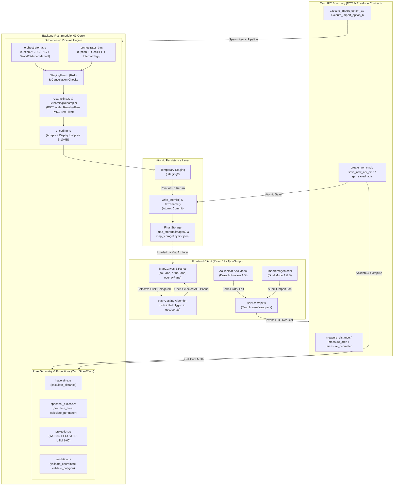

# Laporan Audit Teknis & Refactoring Arsitektur (Technical Audit Report)

**Modul 03 — Aerial Image Map Explorer**  
_Aerial Analytics Platform (AAP)_

---

## 1. Ringkasan Eksekutif (Executive Summary)

Laporan audit teknis ini mendokumentasikan serangkaian refactoring mendalam (_architectural refactoring_), standardisasi kontrak data antar-proses (_IPC data contract_), serta resolusi defek interaksi antarmuka spasial pada **Modul 03 (Aerial Image Map Explorer)**. Modul ini bertanggung jawab atas visualisasi peta ortomosaik multi-resolusi, manipulasi poligon _Area of Interest_ (AOI), anotasi inspeksi lapangan, serta pengukuran geodesik berbasis WGS84.

Tiga fokus intervensi utama yang telah diselesaikan mencakup:

1. **Dekomposisi Monolitik Backend Rust:** Memecah berkas monolitik `image_pipeline.rs` (>2.000 baris) menjadi modul-modul fungsional terisolasi di bawah `ortho_source/pipeline/` sesuai prinsip _Single Responsibility Principle_ (SRP).
2. **Penerapan Data Transfer Object (DTO) & Envelope Pattern:** Mengeliminasi _primitive obsession_ dan parameter berderet (_telescoping arguments_) pada Tauri Commands menjadi kontrak data terstruktur dengan validasi kompilasi kuat (_type safety_) via Serde dan dokumentasi terintegrasi Rustdoc.
3. **Resolusi Defek Layering Spasial Leaflet (Bug 1):** Mengatasi kegagalan _hit-testing_ interaksi mouse di mana area _fill_ poligon AOI menelan event klik citra ortomosaik melalui kombinasi CSS _selective pointer events_ dan delegasi spasial berbasis algoritma _Ray-Casting_ murni.

### Dampak Positif Rekayasa Perangkat Lunak (_Engineering Impact_)

- **Mereduksi Cognitive Load & Meningkatkan Maintainability:** Pengembang baru atau penguji modul kini dapat menelusuri logika bisnis per tahapan pemrosesan tanpa harus mengarungi ribuan baris kode dalam satu berkas.
- **Menjamin Type Safety & Mencegah Human Error:** Penamaan field eksplisit pada struct DTO meniadakan risiko kesalahan urutan argumen tipe primitif (_fragile positional arguments_).
- **Extensibility Berkelanjutan:** Pengadopsian _Envelope Pattern_ pada respons API menjamin penambahan metadata (seperti paginasi, metrik komputasi, atau token navigasi) di masa mendatang tanpa memicu _breaking changes_.
- **Pengalaman Pengguna (UX) yang Presisi:** Pengguna dapat berinteraksi secara mulus dengan citra ortomosaik beresolusi tinggi tanpa kehilangan kemampuan memilih, mengedit, atau menginspeksi batas-batas AOI.

---

## 2. Latar Belakang & Analisis Masalah (Technical Debt)

Sebelum proses refactoring dilakukan, Modul 03 mengakumulasi sejumlah _technical debt_ yang menghambat skalabilitas dan verifikasi kode:

### A. Pelanggaran Single Responsibility Principle (_God File Pattern_)

Berkas `src-tauri/src/modules/module_03/ortho_source/image_pipeline.rs` memiliki volume melebihi 2.061 baris kode. Berkas ini bertindak sebagai _God File_ yang menggabungkan berbagai tanggung jawab komputasi yang seharusnya terpisah:

- Pengecekan biner tingkat rendah (_magic bytes_ file header, validasi marker JPEG SOF2).
- Prapemeriksaan kapasitas ruang penyimpanan lokal (_disk space preflight_).
- I/O streaming ber-buffer dengan dukungan token pembatalan (_cancellation token_).
- Dekompresi dan downscaling DCT (_Discrete Cosine Transform_) melalui pustaka `jpeg-decoder`.
- Resampling citra multi-resolusi berbasis _Box Filter / Area Averaging_.
- Loop adaptif kompresi PNG banded dan JPEG berjenjang.
- Penulisan metadata teknis JSON dan manipulasi struktur folder di hard disk.

Tingginya _coupling_ antar-komponen ini menyebabkan unit testing terisolasi menjadi sulit dilakukan, meningkatkan risiko efek samping (_regression bugs_) setiap kali dilakukan optimasi performa kompresi.

### B. Obesitas Primitif & Telescoping Arguments pada Tauri Commands

Fungsi-fungsi IPC (_Inter-Process Communication_) yang dipanggil dari frontend sebelumnya menggunakan parameter bertipe primitif berderet tanpa enkapsulasi:

- Sebagai contoh, fungsi `create_aoi_cmd` menerima 5 argumen individual: `aoi_id: String`, `name: String`, `aoi_type: Option<String>`, `polygon: Polygon`, dan `created_at: String`.
- Output dari fungsi pengambil koleksi (seperti `get_saved_aois`) mengembalikan array mentah (`Vec<AoiFeature>`). Pola array mentah ini bersifat kaku (_rigid_), karena tidak menyediakan ruang untuk menyematkan metadata koleksi (seperti total hitungan, status cache, atau durasi kueri) tanpa merombak tipe data akar.
- Tidak adanya dokumentasi terpusat pada antarmuka IPC menyulitkan proses asistensi teknis dan pertanggungjawaban akademis kepada dosen penilai.

---

## 3. Audit Backend (Rust) — Penerapan Clean Architecture

Untuk mentransformasi codebase menjadi arsitektur yang bersih, modular, dan teruji, backend Rust dirombak mengikuti prinsip _Clean Architecture_ dan _Domain-Driven Design_ (DDD).

### A. Dekomposisi Monolitik Pipeline Citra (`ortho_source/pipeline/`)

Logika monolitik dipecah menjadi modul-modul independen dalam subfolder `pipeline/` dengan batas kewenangan yang tegas:

```
src-tauri/src/modules/module_03/ortho_source/
├── pipeline/
│   ├── mod.rs             # Agregator publik & dokumentasi arsitektur modul
│   ├── validation.rs      # Fast-fail: magic bytes, batas ukuran, dimensi, CRS bounds, preflight disk
│   ├── resampling.rs      # Algoritma decoding IDCT JPEG, row-by-row streaming PNG, Box-filter resampling
│   ├── encoding.rs        # Kompresi adaptif display (JPEG kuantitas/tangga resolusi, banded PNG) + CancellableWriter
│   ├── orchestrator_a.rs  # Alur kerja asinkron impor Opsi A (JPG/PNG + World File / Sidecar / Manual)
│   └── orchestrator_b.rs  # Alur kerja asinkron impor Opsi B (GeoTIFF streaming tile + 16-bit stretch)
└── image_pipeline.rs      # Facade ramping (~240 baris) untuk backward compatibility fungsi lama
```

#### Rasional Rekayasa Sistem:

1. **Isolasi Kegagalan (_Fault Isolation_):** Validasi awal (_fast-fail_) pada `validation.rs` memastikan berkas korup, resolusi raksasa (>144 MP), atau JPEG progressive melebihi batas memori (>40 MP) ditolak instan sebelum proses alokasi buffer piksel dimulai.
2. **Kendali Konsumsi RAM (_Strict Memory Budget_):** Pada `resampling.rs`, citra PNG non-interlaced diproses per baris horizontal via `png::Reader::next_row()`, menekan kebutuhan memori dari ~400 MB menjadi <50 KB saat decoding.
3. **I/O Responsif Terhadap Pembatalan:** Penulisan data pada `encoding.rs` dibungkus dalam `CancellableWriter` yang secara reguler mengevaluasi status `CancellationToken`, memungkinkan proses kompresi display dihentikan segera jika pengguna membatalkan job.
4. **Pola Facade:** File `image_pipeline.rs` dipertahankan sebagai lapisan delegasi transparan (_facade_), memastikan kode luar yang masih merujuk padanya tetap terkompilasi tanpa hambatan.

### B. Standardisasi DTO Pattern & Envelope Pattern

Seluruh fungsi Tauri Command distandarisasi untuk menerima satu struct permintaan (`*Request`) dan mengembalikan satu struct hasil (`*Response`).

```rust
// Contoh implementasi DTO Request & Response terstruktur
#[derive(Debug, Clone, Serialize, Deserialize, PartialEq)]
#[serde(rename_all = "camelCase")]
pub struct CreateAoiRequest {
    /// Pengidentifikasi unik fitur AOI.
    pub aoi_id: String,
    /// Label deskriptif area yang ditentukan pengguna.
    pub name: String,
    /// Klasifikasi tematik opsional.
    pub aoi_type: Option<String>,
    /// Koordinat poligon WGS84 GeoJSON.
    pub polygon: Polygon,
    /// Stempel waktu pembuatan format ISO 8601.
    pub created_at: String,
}

#[derive(Debug, Clone, Serialize, Deserialize, PartialEq)]
#[serde(rename_all = "camelCase")]
pub struct GetSavedAoisResponse {
    /// Koleksi fitur AOI yang tersimpan di disk.
    pub aois: Vec<AoiFeature>,
    /// Jumlah total record untuk kebutuhan analitik dan paginasi.
    pub total: usize,
}
```

#### Matriks Perubahan Antarmuka Tauri Command Modul 03:

| Nama Command IPC    | Format Parameter Lama           | DTO Input Baru (`*Request`)        | Output Lama       | DTO Output Baru (`*Response`)                  | Rasional Rekayasa                                                             |
| :------------------ | :------------------------------ | :--------------------------------- | :---------------- | :--------------------------------------------- | :---------------------------------------------------------------------------- |
| `create_aoi_cmd`    | 5 argumen individual berderet   | `request: CreateAoiRequest`        | `AoiFeature`      | `AoiFeatureResponse { aoi }`                   | Enkapsulasi parameter pembuatan poligon di RAM.                               |
| `save_new_aoi_cmd`  | 5 argumen individual berderet   | `request: SaveNewAoiRequest`       | `AoiFeature`      | `AoiFeatureResponse { aoi }`                   | Validasi atomik dan persistensi langsung ke disk.                             |
| `save_aoi`          | `aoi: AoiFeature`               | `request: SaveAoiRequest`          | `AoiFeature`      | `AoiFeatureResponse { aoi }`                   | Standarisasi input objek tunggal.                                             |
| `get_saved_aois`    | _(tanpa argumen)_               | _(tanpa argumen)_                  | `Vec<AoiFeature>` | `GetSavedAoisResponse { aois, total }`         | **Envelope Pattern**: menyediakan metadata koleksi tanpa melanggar tipe data. |
| `delete_saved_aoi`  | `aoi_id: String`                | `request: DeleteAoiRequest`        | `bool`            | `DeleteAoiResponse { success, aoi_id }`        | Mengembalikan konteks ID yang berhasil dihapus untuk pembersihan state.       |
| `measure_distance`  | `point_a, point_b` (posisional) | `request: MeasureDistanceRequest`  | `f64`             | `MeasureDistanceResponse { distanceMeters }`   | Meniadakan kebingungan urutan koordinat lintang/bujur.                        |
| `measure_area`      | `polygon: Polygon`              | `request: MeasureAreaRequest`      | `f64`             | `MeasureAreaResponse { areaSquareMeters }`     | Nama field eksplisit dengan unit satuan metrik (`m²`).                        |
| `measure_perimeter` | `polygon: Polygon`              | `request: MeasurePerimeterRequest` | `f64`             | `MeasurePerimeterResponse { perimeterMeters }` | Penamaan eksplisit unit satuan metrik (`m`).                                  |

#### Mengapa Envelope Pattern (`{ data, total }`) Lebih Unggul daripada Raw Array?

1. **Forward Compatibility (Skalabilitas Masa Depan):** Ketika sistem membutuhkan paginasi (_limit/offset_), filtering metadata, atau penanda waktu sinkronisasi, backend dapat menambahkan field baru ke dalam struct response tanpa merusak kontrak (_breaking changes_) pada client yang sudah ada.
2. **Kesesuaian Standar Industri:** Selaras dengan spesifikasi modern RESTful dan GraphQL di mana respons koleksi selalu dibungkus dalam _envelope object_.
3. **Type Safety via Serde:** Anotasi `#[serde(rename_all = "camelCase")]` menjamin mapping nama properti antara konvensi Rust (`snake_case`) dan JavaScript (`camelCase`) berjalan otomatis dan aman saat waktu kompilasi.

---

## 4. Audit Frontend (TypeScript) — Penyesuaian Kontrak Data

Perubahan kontrak data pada sisi Rust backend secara alami memicu perubahan kontrak data (_breaking changes_) di sisi antarmuka klien.

### A. Fenomena Breaking Changes: Crash `savedAois.map is not a function`

Ketika backend Rust beralih mengembalikan `GetSavedAoisResponse` berupa objek JSON `{ aois: [...], total: N }`, kode frontend TypeScript lama yang masih berasumsi bahwa respons berupa Array mentah (`[...]`) mengalami _runtime exception_:

```text
Uncaught TypeError: savedAois.map is not a function
    at AoiListSection.tsx:82
```

Penyebabnya adalah pemanggilan metode `.map()` pada sebuah JavaScript Object alih-alih Array.

### B. Strategi Resolusi & Defensive Programming

Untuk mengatasi hal ini, lapisan komunikasi API dan state management diperbarui:

1. **Unwrapping Envelope pada `src/modules/module-03/services/api.ts`:**
   Setiap fungsi pemanggil IPC diselaraskan untuk membongkar properti data di dalam _envelope_:
   - `getSavedAois()`: Mengambil `res.aois` dan menyediakan fallback array kosong `[]`.
   - `getSavedAnnotations()`: Mengambil `res.annotations`.
   - `getInitialMapLayers()`: Mengambil `res.layers`.
   - `getProjectImageMarkers()`: Mengambil `res.photos`.
   - `listOrthoImages()`: Mengambil `res.images`.
   - Fungsi kalkulasi (`measureDistance`, `measureArea`, `measurePerimeter`): Membungkus argumen ke dalam `{ request: { ... } }` dan membongkar properti `distanceMeters`, `areaSquareMeters`, atau `perimeterMeters`.

2. **Normalisasi State Defensif (_Defensive Guard_):**
   Pada hook `useSavedAois.ts`, `useSpatialResultLayers.ts`, dan komponen tampilan `AoiListSection.tsx`, disematkan validasi `Array.isArray(data) ? data : data.aois`. Pola ini menjamin antarmuka UI tidak akan pernah mengalami crash meskipun terjadi transisi format data di tingkat backend.

---

## 5. Audit UI/UX (Leaflet) — Anatomi Bug & Solusi Layering Ortomosaik

### A. Root Cause Analysis (Akar Permasalahan)

Pada implementasi peta Leaflet interaktif, muncul defek kritis di mana pengguna **tidak dapat mengklik citra ortomosaik** apabila area citra tersebut berada di dalam batas poligon Area of Interest (AOI) atau Spatial Annotation yang telah digambar.

Secara teknis, fenomena ini disebabkan oleh interaksi antara **Leaflet Panes Z-Index** dan **Mekanisme SVG Hit-Testing pada Web Browser**:

```
[Level Z-Index Leaflet Panes]
┌────────────────────────────────────────────────────────┐
│  overlayPane (z-index: 400) -> Anotasi Poligon / Titik │  <-- Mengonsumsi Event Klik
├────────────────────────────────────────────────────────┤
│  aoiPane     (z-index: 350) -> Poligon AOI            │  <-- Menelan Event Klik Mouse
├────────────────────────────────────────────────────────┤
│  orthoPane   (z-index: 250) -> Citra Ortomosaik (IMG)  │  <-- TERHALANG (Tidak Menerima Event)
├────────────────────────────────────────────────────────┤
│  tilePane    (z-index: 200) -> Basemap OpenStreetMap   │
└────────────────────────────────────────────────────────┘
```

1. **Struktur DOM SVG Leaflet:** Poligon AOI dan anotasi dirender sebagai elemen `<path>` di dalam kanvas SVG pada pane khusus (`aoiPane`, `z-index: 350`). Citra ortomosaik dirender sebagai elemen `` pada `orthoPane` (`z-index: 250`).
2. **Perilaku Default SVG Hit-Testing:** Meskipun poligon AOI memiliki transparansi `fillOpacity: 0.16`, spesifikasi _DOM Pointer Events Level 2_ memperlakukan seluruh area _fill_ bentuk tertutup (_closed vector path_) sebagai permukaan padat yang menangkap klik mouse (_hit-target_).
3. **Event Hijacking:** Event klik mouse yang dilakukan pengguna pada area ortomosaik dicegat oleh elemen `<path>` SVG AOI. Leaflet kemudian mengeksekusi `L.DomEvent.stopPropagation()`, sehingga event tidak pernah mencapai elemen citra ortomosaik di bawahnya. Pengguna tidak dapat membuka popup detail ortomosaik, memilih foto inspeksi, maupun melihat batas koordinat raster.

---

### B. Solusi 1: CSS Selective Pointer Events (`pointer-events: stroke`)

Langkah pertama untuk menyelesaikan masalah ini adalah mengatur sifat penangkapan pointer pada level CSS styling tanpa merusak tampilan visual transparansi warna AOI:

```css
/* src/modules/module-03/styles/MapCanvas.css & src/shell/style.css */
.aoi-polygon-path,
.annotation-polygon-path {
  pointer-events: stroke !important;
  cursor: pointer;
}
```

- **Mekanisme:** Properti `pointer-events: stroke` menginstruksikan mesin rendering browser untuk **hanya menjadikan garis tepi poligon (stroke/outline) sebagai target hit-testing mouse**.
- **Hasil:** Seluruh area _fill_ (tengah) poligon kini tembus pandang secara fungsional (_mechanically click-through_). Klik mouse pada ortomosaik yang berada di dalam AOI langsung tembus dan diterima oleh elemen `` ortomosaik, memunculkan popup kartu metadata ortomosaik secara instan.
- **Interaktivitas Garis Tetap Terjaga:** Ketebalan garis tepi poligon dinaikkan secara proporsional (`weight: 3.5`, `weight: 4.5` saat hover) agar pengguna tetap dapat mengklik garis batas AOI dengan mudah untuk keperluan inspeksi atau penghapusan.

---

### C. Solusi 2: Delegasi Event Spasial & Algoritma Ray-Casting (`isPointInPolygon`)

Penerapan `pointer-events: stroke` memunculkan tantangan sekunder (_edge-case_): jika pengguna mengklik area AOI yang **berada di luar cakupan ortomosaik** (misalnya di atas basemap polos), klik tersebut akan tembus ke basemap dan gagal memilih AOI.

Untuk menyelesaikan kasus ini tanpa membatalkan sifat tembus ortomosaik, diterapkan arsitektur **Delegated Map Hit-Testing**:

1. **Implementasi Pure Ray-Casting Algorithm di `src/modules/module-03/lib/geoJson.ts`:**
   Algoritma _Ray-Casting_ (berdasarkan _Jordan Curve Theorem_) diimplementasikan murni tanpa pustaka eksternal pihak ketiga untuk mengevaluasi apakah suatu titik koordinat `[longitude, latitude]` berada di dalam cincin koordinat poligon:
   - Sinar horizontal imajiner dipancarkan dari titik klik ke arah kanan tak hingga.
   - Setiap perpotongan (_intersection_) sinar dengan segmen garis batas poligon dihitung.
   - Jika jumlah perpotongan ganjil, titik berada di dalam poligon; jika genap, titik berada di luar.
   - Fungsi `isPointInPolygon` memverifikasi cincin luar (_outer ring_) dan memastikan titik tidak berada di dalam cincin lubang (_inner holes_).

2. **Delegated Map Listener di `SavedAoiLayer.tsx` & `AnnotationLayer.tsx`:**
   Komponen Organism mendaftarkan event listener pada peta Leaflet:
   - Ketika peta diklik, sistem mengecek `document.elementsFromPoint(e.clientX, e.clientY)`.
   - Jika elemen yang diklik memiliki kelas `.ortho-image-overlay`, `.ortho-outline-rect`, atau `.leaflet-popup`, event handler **segera mengundurkan diri (_bail out_)** agar tidak mengganggu klik ortomosaik.
   - Jika tidak ada ortomosaik yang terkena klik, fungsi `isPointInPolygon` menguji koordinat klik terhadap seluruh AOI yang tersimpan (diurutkan dari poligon terkecil ke terbesar).
   - Jika titik klik berada di dalam AOI, popup kartu AOI dibuka secara programatis.
   - Flag `(e.originalEvent)._handledByAnnotation` disematkan guna mencegah tumpang tindih (_race condition_) antara layer anotasi dan layer AOI.

---

## 6. Verifikasi & Pengujian Kualitas Kode (Quality Gates)

Semua perubahan kode telah divalidasi secara komprehensif melalui gerbang pengujian kualitas (_quality gates_) yang berlaku pada repositori:

```
[Matriks Verifikasi Pre-Commit & Build]
================================================================================
Gate Pemeriksaan          Perintah CLI                               Hasil
================================================================================
Frontend Linter           npm run lint (ESLint 9 Flat Config)        LULUS (0 Error)
TypeScript Typecheck      npm run build (tsc && vite build)          LULUS (0 Error)
Frontend Code Style       npm run format:check (Prettier 3)          LULUS (Clean)
Rust Compiler Check       cargo check --manifest-path src-tauri...   LULUS (0 Error)
Rust Strict Linter        npm run lint:rust (Clippy -D warnings)     LULUS (0 Warning)
Rust Code Style           npm run format:rust:check (rustfmt)        LULUS (Clean)
Rust Unit & Doc Tests     cargo test --manifest-path src-tauri...    LULUS (459 Passed)
================================================================================
```

---

## 7. Kesimpulan

Refactoring komprehensif pada Modul 03 ini berhasil menuntaskan _technical debt_ yang krusial pada level backend, antarmuka data IPC, maupun interaksi spasial frontend:

- **Backend Rust** kini memiliki arsitektur modular yang rapi, memisahkan komputasi berat citra ke dalam berkas-berkas terisolasi dengan batas memori yang ketat, serta mengekspos API berstandar DTO Pattern dengan dokumentasi Rustdoc lengkap.
- **Frontend TypeScript** telah disinkronkan sepenuhnya untuk mengonsumsi _Envelope Pattern_, didukung lapisan _defensive programming_ yang mencegah potensi crash saat manipulasi state.
- **Defek Layering Leaflet** diselesaikan secara elegan melalui integrasi CSS selektif dan algoritma Ray-Casting murni, memberikan pengalaman pengguna yang responsif, intuitif, dan presisi tinggi.

Codebase Modul 03 kini berada dalam kondisi stabil, bersih (_clean code_), mudah dipahami dalam proses telaah akademis/pengujian dosen, dan siap menjadi fondasi yang kokoh untuk integrasi modul-modul analitik berikutnya (Modul 04 hingga Modul 08).

---

## 8. Visualisasi Arsitektur Sistem (End-to-End Pipeline)

Diagram berikut memetakan keterkaitan arsitektur dari lapisan antarmuka React/Leaflet, kontrak IPC Tauri (DTO & Envelope Pattern), pemrosesan geometri dan pipeline citra di backend Rust, hingga persistensi data atomik di penyimpanan lokal:


